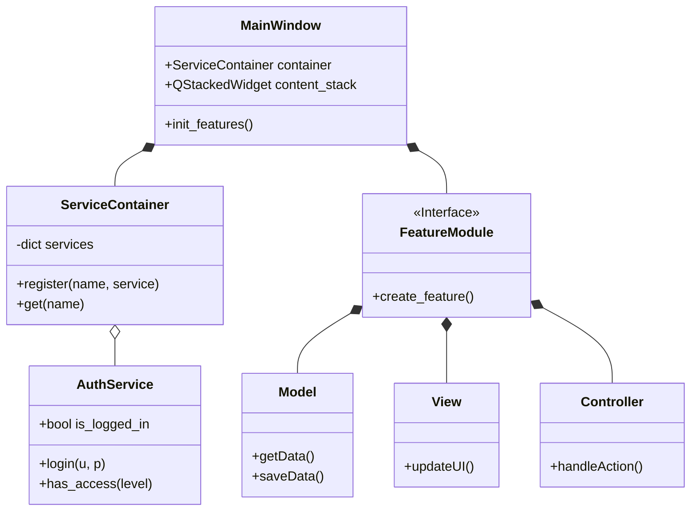
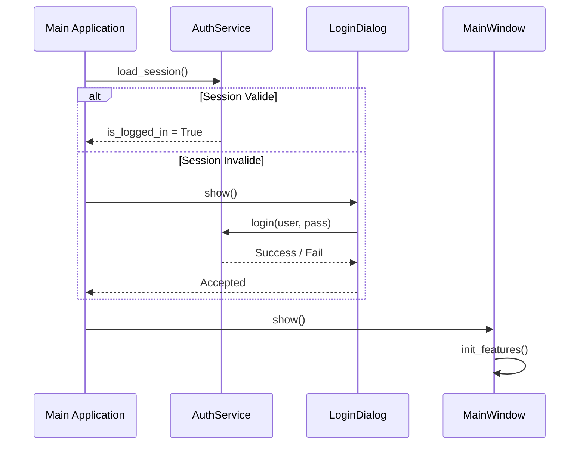
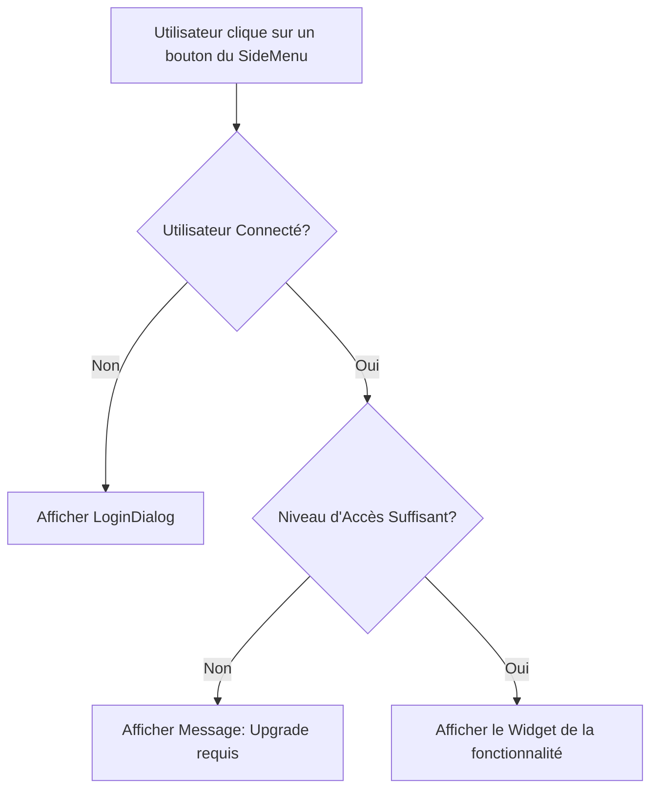

# Diagrammes Conceptuels - Leopardo AI

Ce document utilise la syntaxe Mermaid pour représenter graphiquement l'architecture du système.

## 1. Diagramme de Classe Simplifié (Architecture MVC)

## 2. Diagramme de Séquence : Authentification et Chargement

## 3. Diagramme de Flux : Accès aux Fonctionnalités

